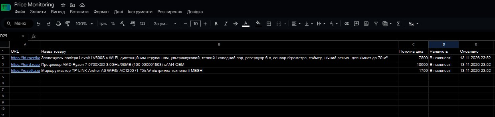

# Моніторинг цін у Google Таблицях

Python-скрипт автоматично читає посилання на товари з Google Таблиці, відкриває сторінки через Playwright і оновлює назву, ціну, наявність та час перевірки у відповідних комірках.



## Функціонал

- Читає URL товарів зі стовпця A Google Таблиці, починаючи з рядка 2
- Відкриває кожну сторінку у фоновому Chromium з `playwright-stealth` і реалістичним User-Agent
- Витягує назву товару, ціну та статус наявності з HTML і schema.org JSON-LD
- Записує результати у стовпці B, C, D і E того самого рядка через `gspread`
- Додає локальний час перевірки у форматі `ДД.ММ.РРРР ГГ:ХХ`
- Виводить українські повідомлення про хід роботи та підсумок успіхів і помилок
- Не зберігає секрети у репозиторії: `.env` і `credentials.json` ігноруються git

## Стек технологій

- `Python 3` (рекомендовано 3.13 або новіший)
- `gspread` - робота з Google Таблицями
- `google-auth` - авторизація сервісного акаунта
- `Playwright` - завантаження сторінок товарів
- `playwright-stealth` - маскування ознак автоматизації
- `BeautifulSoup4` - розбір HTML
- `python-dotenv` - конфігурація через `.env`

## Структура проєкту

- `main.py` - запуск, обхід посилань і вивід у консоль
- `config.py` - читання налаштувань із `.env`
- `sheets_client.py` - підключення до таблиці та запис результатів
- `parser.py` - Playwright, stealth і парсинг картки товару
- `.env.example` - зразок змінних середовища
- `credentials.example.json` - шаблон ключа сервісного акаунта
- `assets/preview.png` - демонстрація заповненої таблиці

## Формат Google Таблиці

Скрипт працює з першим аркушем. Перший рядок - заголовки. Посилання беруться зі стовпця A, починаючи з рядка 2.

| A | B | C | D | E |
| --- | --- | --- | --- | --- |
| URL / посилання | Назва товару | Поточна ціна | Наявність | Оновлено |

Приклад статусів у стовпці D: `В наявності`, `Немає в наявності`, `Під замовлення`, `Закінчується`, `Невідомо`, `Помилка`.

Порожні комірки у стовпці A пропускаються. Посилання має починатися з `http://` або `https://`.

## Налаштування Google Cloud API

1. Відкрийте [Google Cloud Console](https://console.cloud.google.com/) і створіть новий проєкт.
2. Увімкніть API:
   - Google Sheets API
   - Google Drive API
3. Перейдіть у `IAM і адміністрування` -> `Сервісні акаунти` і створіть сервісний акаунт.
4. Створіть ключ типу JSON і завантажте файл.
5. Збережіть ключ у корені проєкту як `credentials.json` (цей файл не потрапить у git).
6. Створіть Google Таблицю, наприклад з назвою `Price Monitor` або `Price Monitoring`.
7. Натисніть `Поділитися` і надайте роль редактора адресі `client_email` із `credentials.json`.
8. У першому рядку додайте заголовки для стовпців A-E, а з рядка 2 вставте URL товарів у стовпець A.

## Встановлення і запуск

### 1. Клонування

```bash
git clone https://github.com/bitforge-py/gsheets-price-monitor.git
cd gsheets-price-monitor
```

### 2. Віртуальне середовище і залежності

PowerShell:

```powershell
py -3.14 -m venv .venv
.\.venv\Scripts\python.exe -m pip install -r requirements.txt
.\.venv\Scripts\python.exe -m playwright install chromium
```

Bash:

```bash
python3 -m venv .venv
source .venv/bin/activate
pip install -r requirements.txt
python -m playwright install chromium
```

### 3. Конфігурація

Скопіюйте шаблони і заповніть їх:

```powershell
copy .env.example .env
copy credentials.example.json credentials.json
```

У `.env` вкажіть точну назву вашої таблиці і шлях до ключа:

```
SPREADSHEET_NAME="Price Monitor"
CREDENTIALS_FILE="credentials.json"
```

У `credentials.json` вставте вміст ключа сервісного акаунта з Google Cloud.

### 4. Запуск

```powershell
.\.venv\Scripts\python.exe main.py
```

або:

```bash
python main.py
```

Приклад виводу:

```
Підключення до таблиці «Price Monitor»...
Сервісний акаунт: price-monitor@project.iam.gserviceaccount.com
Знайдено посилань: 3
[1/3] Рядок 2: https://shop.example/tovar
  Назва: Навушники TestPro
  Ціна: 1999 грн
  Наявність: В наявності
Готово. Успішно: 3. З помилками: 0.
```

Між сторінками є пауза в 1 секунду. Час у стовпці E береться з локального годинника комп'ютера.

## Як визначаються поля

- **Назва**: schema.org JSON-LD, далі `h1`, `og:title`, `twitter:title` або заголовок сторінки
- **Ціна**: JSON-LD (`price` / `lowPrice`), метатег `product:price:amount`, `itemprop="price"` і типові CSS-селектори ціни
- **Наявність**: поле `availability` з JSON-LD або типові блоки статусу на сторінці

Однозначне число записується у таблицю числом. Діапазон або ціна «від» зберігається рядком із позначкою грн.

## Безпека

У `.gitignore` обов'язково ігноруються:

- `.venv`
- `.env`
- `credentials.json`
- `__pycache__/`

У репозиторій потрапляють лише шаблони `.env.example` і `credentials.example.json`. Не комітьте реальний ключ сервісного акаунта.

## Типові ситуації

- Таблицю не знайдено: перевірте `SPREADSHEET_NAME` і доступ редактора для `client_email`
- Браузер не запускається: виконайте `python -m playwright install chromium` у цьому віртуальному середовищі
- Ціна порожня, а наявність `Невідомо`: сторінка відкрилася, але без типової картки товару
- Статус `Помилка`: магазин не віддав сторінку вчасно або відповів кодом помилки

## Ліцензія

Проєкт поширюється для навчальних і особистих цілей. Дотримуйтесь правил сайтів, які ви перевіряєте, і не публікуйте секретні ключі.
